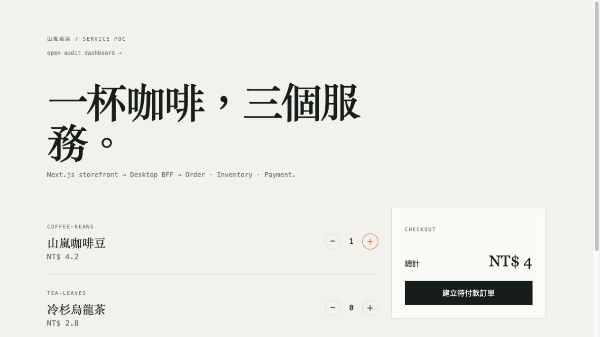

# Commerce microservices PoC



Next.js storefront → Desktop BFF → Order / Inventory / Payment → Audit Worker.
App clients use a separate App BFF with a native payment response contract.
Node.js 22 and Go 1.27.2 are used by deployment images and CI.

Order owns a durable SQLite checkout Saga. Inventory reservations are atomic;
server catalog prices determine totals. Idempotent mutations and audit outboxes
are committed with business data. Recovery survives service restarts and a lost
upstream response. Payment reconciliation repairs Order without a client retry.
SQLite services and the Website session registry remain single replica.

## Identity and permissions

Protected BFF routes require a verified OAuth access token. The website uses OIDC
Authorization Code / PKCE with encrypted server-side sessions, HttpOnly reference cookies and CSRF protection.
Order and Checkout reads, and simulated Payment confirmation, require ownership.
Audit reads require `audit:read` or `audit-reader`. Catalog and health are public.
Body user IDs and actor headers cannot impersonate another user.

Calls to BFF and domain-service listeners use TLS 1.3 and per-peer signing keys. Signatures bind the
method, path, body, recipient, actor, scopes, idempotency key and correlation ID.
Fresh nonces and timestamps prevent replays. Each service permits only specific
callers and operations. Payment independently checks ownership through Order.
Background Saga and outbox jobs use service credentials, preserving the original
actor without storing a user access token. See [SECURITY.md](SECURITY.md).

## Start an isolated local environment

Prerequisites: Node.js 22+, OpenSSL, Docker with Compose, curl and jq.
The explicit development override runs Keycloak 26.8.0 with generated test users.
It is a local/CI environment and must not be deployed to production.

```bash
node scripts/init-security.mjs
export COMPOSE_FILE=docker-compose.yml:docker-compose.dev.yml
export COMPOSE_ENV_FILES=.env.security
export COMPOSE_PROJECT_NAME=commerce-security-local
docker compose up --build -d
```

The initializer writes random credentials to `.env.security`, a generated realm
and local CA/certificates to `.security/`. Both paths are ignored by Git. Existing
env files are preserved; use another output path to create a new configuration.
Regeneration replaces the local realm and PKI files: stop and remove the dedicated
test containers first. Certificates expire after 30 days.

Open http://localhost:3000 and choose **登入**. Users are `alice`, `bob` and `auditor`;
look up the corresponding `TEST_*_PASSWORD` in your local `.env.security` file.
Only `auditor` can read the audit dashboard. The local provider is at
http://localhost:9091. The website's development origin uses HTTP; internal APIs
still require trusted TLS certificates.

Default host endpoints:

| Component | Endpoint |
| --- | --- |
| Website | http://localhost:3000 |
| Desktop BFF | https://localhost:3001 |
| App BFF | https://localhost:3002 |
| Order / Inventory / Payment / Audit | https://localhost:8081 / 8082 / 8083 / 8084 |

Internal service host ports are provided only by the development override and
bind to loopback. Base Compose requires external identity settings, signing keys
and `SERVICE_PKI_DIR`; internal services do not publish host ports.
The public website needs HTTPS termination for Secure cookies in production.
Set port variables before initialization to avoid conflicts with existing stacks.

## Call the APIs

The test client uses a password grant only in the generated development realm.
It is separate from the website's authorization-code client.

```bash
node scripts/test-tokens.mjs
set -a
source .security/tokens.env
set +a
curl --cacert .security/pki/ca.pem --fail \
  -H "Authorization: Bearer $ALICE_TOKEN" \
  -H 'Content-Type: application/json' -H 'Idempotency-Key: example-order-1' \
  -d '{"items":[{"sku":"mug","quantity":1}]}' \
  https://localhost:3001/api/checkout
```

Checkout can return `202` with `checkoutId`; poll `/api/checkouts/{id}` with the
same user's token until ready. Ready Desktop responses include `order`, `payment`
and `inventory`; App responses include `orderId`, `amount`, `payment.clientToken`
and `reservationId`. A repeated owner/channel/key returns the same workflow.
The same key used by another owner creates a separate workflow.

Use `GET /api/orders/{id}` to read an owned order and
`POST /api/payments/{id}/confirm` to confirm an owned **simulated** payment.
Production settlement requires an authenticated payment-provider integration.
Payment confirmation returns `200` only when Order has also committed Inventory.
It can return `202` with `checkoutId` and `state=settling` while recovery continues;
poll `/api/checkouts/{id}` until `paid`. Payment's `paid` fact alone does not permit
fulfillment. `settling`, `cancelling` and `refund_pending` are non-fulfillable states.

Order owns the settlement workflow. The BFF triggers
`POST /v1/orders/{id}/settlement`; generic Order updates reject `status=paid`.
Inventory commit requires `{ "order_id": "..." }`, checks the deadline atomically,
and treats repeated commits as success without duplicate stock or audit effects.
`RESERVATION_TTL_SECONDS` defaults to 900; nonpositive, malformed or overflowing
values use that default instead of shortening holds or generating past deadlines.
Order publishes `paid`, its checkout snapshot and audit event in one local transaction.
Lost responses retain a durable stage and fixed operation key until resolved.

`POST /api/orders/{id}/cancel` returns `200` when compensation completes, or `202`
with `checkoutId` while it continues. Cancellation competes with settlement through
Order's conditional status update; an order already settling or paid returns `409`.
If payment confirmation wins before cancellation, Order uses the **simulated**
Payment refund operation before completing cancellation. Expired paid holds likewise
enter `refund_pending`; provider refunds must be implemented before using real money.
Only Order may call Payment `/cancel` and `/refund`. A cancelled checkout read returns
`409` with its reason. Clients should not retry checkout creation with a new key while
an existing workflow is still settling or compensating.

On upgrade, old `paid` orders whose checkouts still await payment reconciliation are
quarantined as `settling` before the listener starts and verified through recovery.
Already shipped legacy orders require explicit operational reconciliation. Inventory
holds created before TTL support keep `expires_at=0`; they are not automatically
released, because some belong to sales that the old version never committed.

`GET /api/audit/events` accepts service, event_type, aggregate_id, actor_id,
correlation_id and limit filters, and requires audit permission.

Legacy anonymous user IDs are not automatically assigned to OIDC users. Existing
workflow IDs remain recoverable. Migrating old owners requires an explicit,
reviewed issuer/subject mapping.

## Verify the implementation

```bash
npm ci --prefix bff-api --ignore-scripts
npm ci --prefix website --ignore-scripts
npm test --prefix bff-api
npm test --prefix website
node --test loadtest/commerce.test.mjs
node scripts/settlement-sit.mjs
node scripts/compose-sit.mjs
npm run build --prefix website
for service in security order inventory payment audit-worker; do
  (cd services/$service && go test -race ./...) || break
done
```

Settlement SIT builds the real Go domain services and runs the BFF with a test
identity against newly generated TLS certificates, signing keys and temporary
databases. It injects lost commit/refund responses and outages, restarts Order,
checks cancellation races, and verifies final stock and audit counts. It needs
Go, Node.js 22+, OpenSSL and Python 3; no Docker or existing credentials are used.
Successful runs clean up their processes and temporary files; failed runs retain
isolated diagnostics. Real OIDC remains covered by Security SIT below.

`compose-sit.mjs` copies the service sources into its own ignored artifact directory,
allocates unused local ports and creates a fresh Compose project, credentials and
volumes. It runs both Security SIT and commerce SIT, then removes its containers,
volumes and generated credentials. Logs and `result.json` remain under `artifacts/`.
It supports either `docker compose` or the standalone `docker-compose` executable.

Run integration checks against a dedicated Compose project with fresh volumes:

```bash
NODE_EXTRA_CA_CERTS="$PWD/.security/pki/ca.pem" node scripts/security-sit.mjs
bash scripts/sit.sh
```

Security SIT covers real OIDC login/logout, CSRF, token rejection, cross-user
access, owner-bound idempotency, protected internal calls, Payment-side ownership,
and recovery after the initiating token expires. Existing SIT covers payment and
audit outages, restarts, outbox replay and inventory rejection. These scripts stop
and restart services in the selected project. For nondefault files/ports configure
`SECURITY_ENV_FILE`, the service URL variables and Compose environment accordingly.

Authenticated load tests require a fresh project to preserve seed stock:

```bash
node scripts/test-tokens.mjs
docker run --rm --network host --env-file .security/tokens.env \
  --env SSL_CERT_FILE=/certs/ca.pem \
  --volume "$PWD/.security/pki/ca.pem:/certs/ca.pem:ro" \
  --volume "$PWD/loadtest:/scripts:ro" \
  grafana/k6:0.54.0 run /scripts/commerce.js
```

`--network host` is intended for Linux/CI. On desktop Docker, provide reachable
service URLs. Load tests check 15 Desktop and 6 App completed transactions,
scenario-specific zero failures and latency thresholds. Load clients use public
BFF APIs and wait for Order settlement; they do not receive an inventory signing key.
CI preserves diagnostics and removes its own test containers and volumes.

## Kubernetes

`k8s/poc.yaml` uses ClusterIP services, NetworkPolicies, Secrets and HTTPS Gateway.
Set real hostnames, GatewayClass and data-plane labels, images and storage class.
The manifest requires Gateway API v1.4+ with BackendTLSPolicy support and a CNI
enforcing NetworkPolicy. Set `commerce-gateway` to your installed GatewayClass,
and verify its data-plane pods inherit `commerce-edge=true` in this namespace.
Build Go images with `services/` as context and the service's Dockerfile.

Prepare a `.env.security-production` file containing the real HTTPS issuer/JWKS,
API audience, public website origin, OIDC client credentials, a random 32-byte
base64url session secret, per-peer signing-key maps and `SERVICE_PKI_DIR`.
Service certificates need DNS SANs matching `order`, `inventory`, `payment`,
`audit-worker`, `desktop-bff` and `app-bff`; the CA must match `ca.pem`.
The Gateway verifies the App BFF certificate through BackendTLSPolicy and a
public CA ConfigMap. Gateway API resources require their CRDs/controller.
Do not copy generated development users or their credentials into production.

```bash
kubectl create namespace commerce-poc
node scripts/render-k8s-secrets.mjs .env.security-production
kubectl apply -f .security/k8s-secrets.json
# Supply a trusted certificate covering the configured website/API hosts.
kubectl -n commerce-poc create secret tls commerce-edge-tls \
  --cert=/path/to/edge.crt --key=/path/to/edge.key
kubectl apply -f k8s/poc.yaml
```

Rotate pairwise keys at both endpoints in a coordinated deployment; rotate session
keys to invalidate website sessions. Replace certificates before expiry. Do not
log access tokens, private keys or session cookies. Production SSO and cluster
connectivity need validation with the actual provider and cluster configuration.
